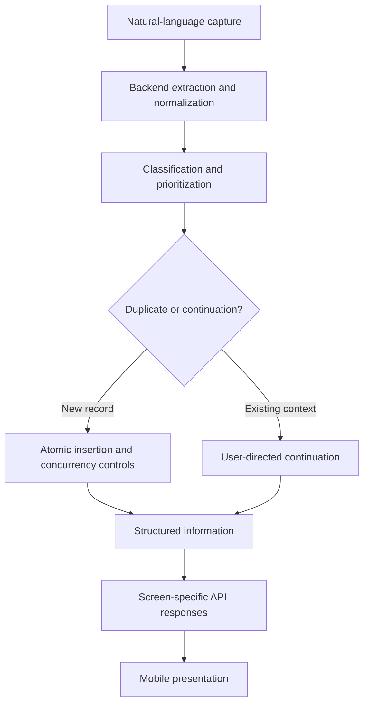

# Priorly
### Intelligent personal organization

An AI-powered personal organization product built by [Ramesh Pingili](https://github.com/rameshpingili1729).

## My role
Independent AI product development | 2026–present

I am building AI-assisted capture workflows that turn natural-language input into organized information and actionable priorities.

## Engineering highlights

- Designed backend extraction, normalization, classification, and prioritization.
- Built screen-specific APIs that return the information each mobile experience needs.
- Separated backend intelligence from mobile presentation.
- Implemented duplicate detection and atomic insertion controls.
- Added concurrency protections and tested simultaneous requests.
- Tested workflow transitions, existing-data compatibility, and failure paths.

## Design principles

| Concern | Approach |
| --- | --- |
| Input processing | Extract, normalize, classify, and prioritize captured information |
| API design | Focused responses for each screen |
| Separation of concerns | Backend intelligence and mobile presentation |
| Data integrity | Duplicate detection, atomic insertion, and concurrency protections |
| Validation | Workflow transitions, simultaneous requests, compatibility, and failure paths |

## Engineering approach

I use coding agents for implementation, debugging, and review while owning architectural decisions. I validate changes against requirements, existing data, integration behavior, and actual user flows.

## Repository scope

This repository is a public product and engineering showcase. Commercial application source code, credentials, and user data are not included.

[Professional profile](https://github.com/rameshpingili1729) · [LinkedIn](https://www.linkedin.com/in/rameshpingili)

## Processing overview

This conceptual view summarizes the responsibilities in the capture workflow; it is not a complete service or deployment diagram.

## Engineering decisions

| Decision | Purpose | What needs validation |
| --- | --- | --- |
| Backend-owned intelligence | Centralize extraction, classification, and prioritization | Different input shapes produce usable structured information |
| Screen-specific API contracts | Return the fields each mobile experience needs | Responses match the screen contract and handle missing data |
| Duplicate detection | Avoid accidental repeat records | Repeated inputs and intentional continuation are distinguished |
| Atomic insertion | Protect data integrity during competing writes | Simultaneous requests do not create unintended duplicates |
| Compatibility handling | Support records created by earlier application versions | Older data shapes remain readable through current APIs |

## A debugging lesson: passing tests and existing data

During development, a coding agent reported a backend fix complete with tests passing. Testing the app in the simulator still exposed an API failure on existing records. The implementation assumed certain fields were objects and called `.get()` on them, while older records stored strings.

I reproduced the failure and worked through a compatibility fix with the agent, adding regression coverage for the older records. The gap was between the data shape represented by the tests and the data already used by the app.

My takeaway: review a fix against actual user flows and existing records as well as the test results. A passing suite is meaningful only within the conditions it covers.

This is a development experience summary. Internal records, logs, and the commercial implementation are not published here.

## Validation focus

| Scenario | Expected property |
| --- | --- |
| Two competing requests for the same new record | Atomic controls preserve the intended single insertion |
| Repeated capture | Duplicate handling follows the product’s intended behavior |
| User-directed continuation | Existing context is handled intentionally |
| Legacy field representation | Current APIs handle supported earlier data shapes |
| Save and reopen | Stored state remains consistent with the user’s action |
| Workflow failure | The user flow and stored data remain understandable and recoverable |

The table describes validation concerns and expected properties. It is not a benchmark or an executable test report.

## Portfolio context

Priorly represents my work in AI product design, backend processing, API contracts, debugging, and data integrity. This showcase documents the engineering approach without publishing commercial source code or private user information.
